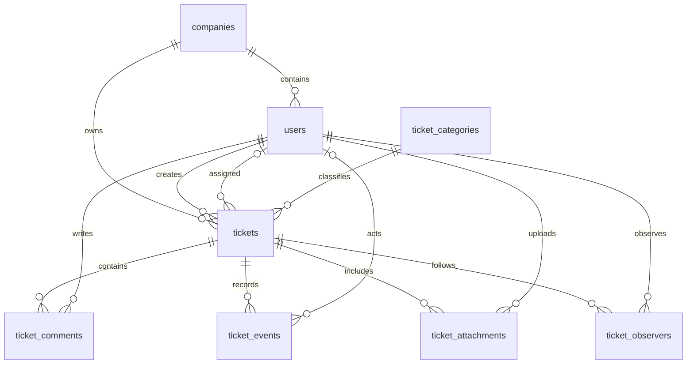

# Modelo de datos

Todas las relaciones del dominio tienen claves foráneas restrictivas para preservar los registros históricos. Las relaciones históricas de tickets y autores incluyen padres borrados lógicamente.

Las prioridades, estados y roles tienen constraints PostgreSQL. El rol client requiere company_id. Los identificadores public_id y ticket_number son únicos; el número no se recicla al borrar lógicamente.

Los eventos usan JSONB para old_values, new_values y metadata, con created_at sin updated_at. Un trigger prohíbe UPDATE/DELETE y el modelo rechaza esas operaciones. Una migración reversible elimina el trigger al eliminar la tabla y luego elimina su función.

Índices del ticket: estado, prioridad, fecha, empresa/estado, agente/estado y categoría/estado. Los índices compuestos cubren búsquedas por su primera columna. Comentarios y eventos se indexan por ticket/fecha.

PostgreSQL 18 es obligatorio tanto en desarrollo como en pruebas. Las bases están separadas: helpdesk para el piloto y helpdesk_testing para pruebas descartables.

TicketObserver conserva la pertenencia de observadores con SoftDeletes, actor de incorporación y unicidad ticket_id/user_id. Su baja no elimina eventos ni comentarios; una reincorporación restaura el registro.

Ticket incorpora contact_phone nullable (40 caracteres). PriorityGuideline almacena una fila por prioridad, criterios, tiempos en minutos y calendario nullable, con SoftDeletes. Una restricción exige todos los plazos vacíos o una configuración completa con respuesta positiva, solución mayor o igual y calendario continuous. Las migraciones inicializan criterios sin asignar plazos.
