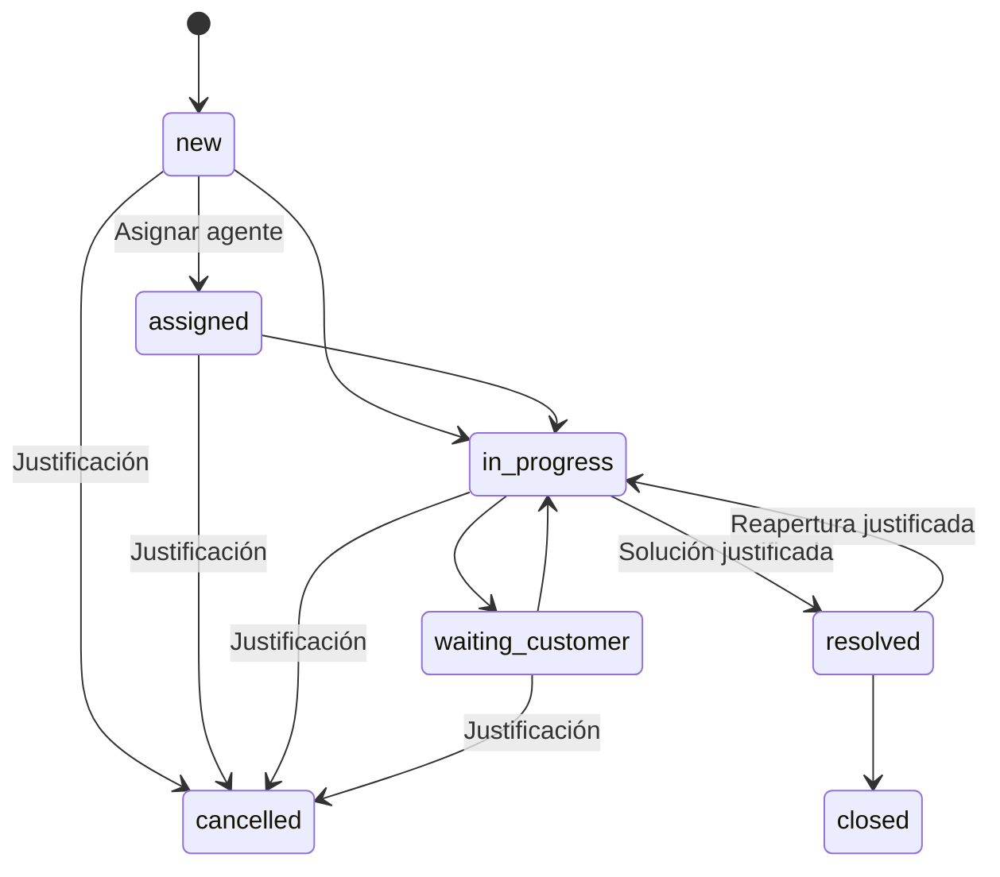

# Flujo de tickets

Los estados se presentan en español. Closed y cancelled son terminales y no permiten comentarios ni nuevos adjuntos. Un ticket resuelto puede reabrirse con explicación; la reapertura limpia resolved_at y conserva el evento anterior. El cierre establece closed_at y mantiene resolved_at.

La asignación a un agente activo cambia new a assigned. Reasignar conserva otros estados y registra responsable anterior/nuevo. No se asignan tickets resueltos, cerrados ni cancelados. El estado assigned exige responsable.

Los clientes crean tickets y comentarios visibles para su empresa. El personal interno asigna, cambia prioridad y estado, comenta y escribe notas internas. La primera respuesta pública del personal fija first_responded_at; una nota interna no lo modifica.

Los historiales internos muestran cambios y justificaciones. El historial del cliente excluye los eventos de notas internas. No se permite editar o borrar comentarios desde la interfaz para mantener trazabilidad.
